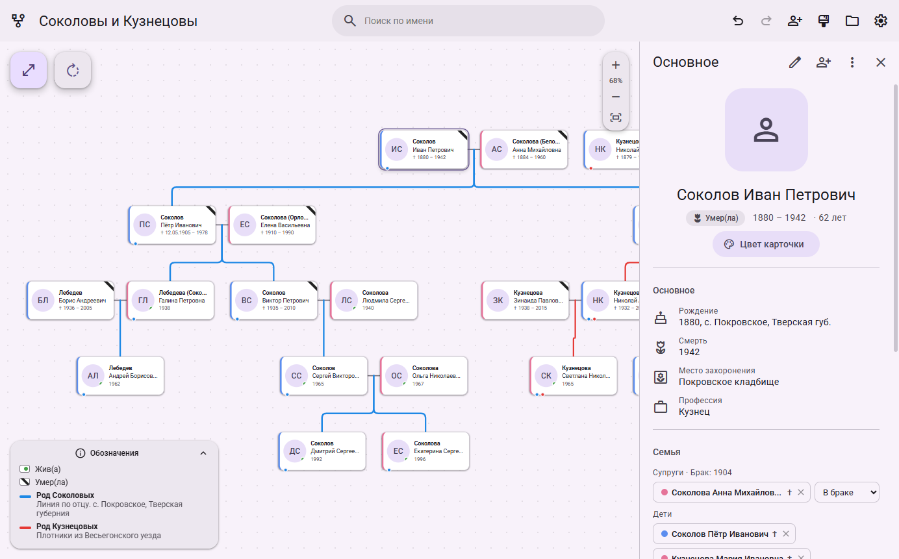
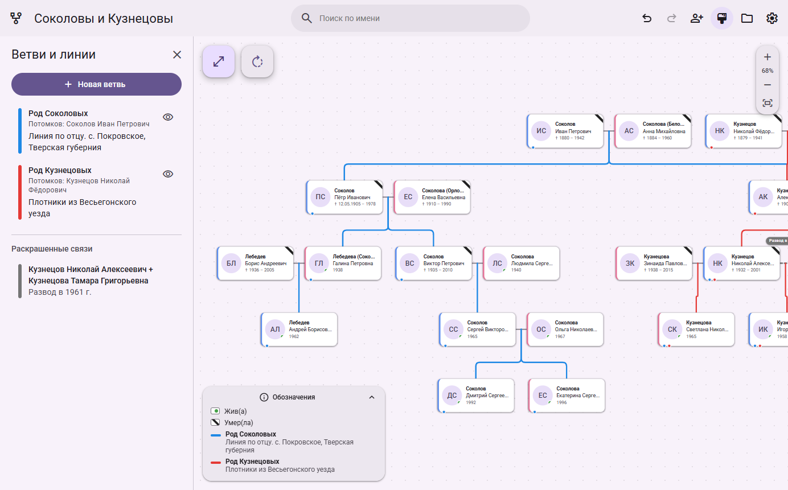
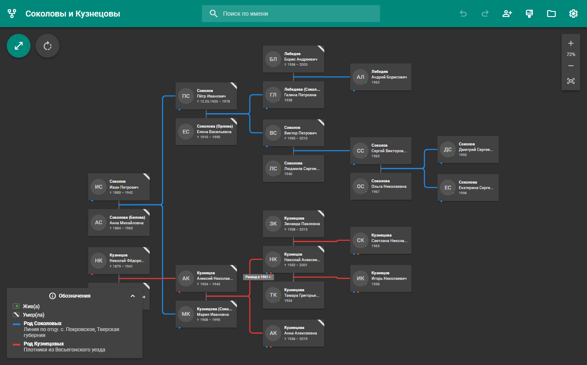
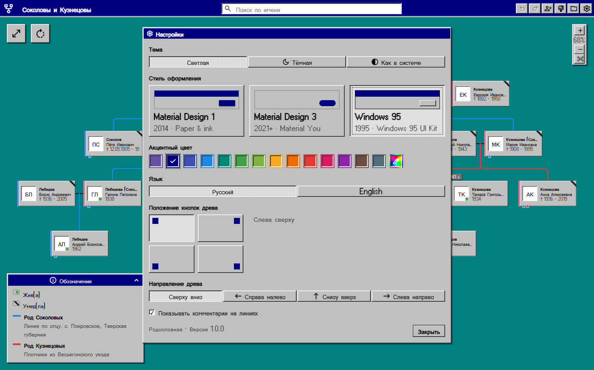
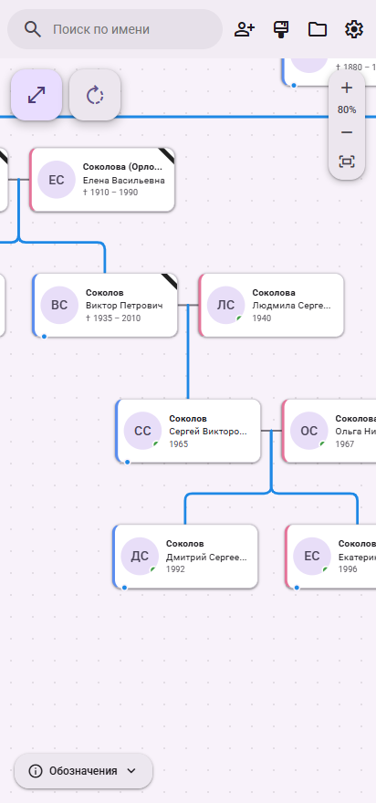
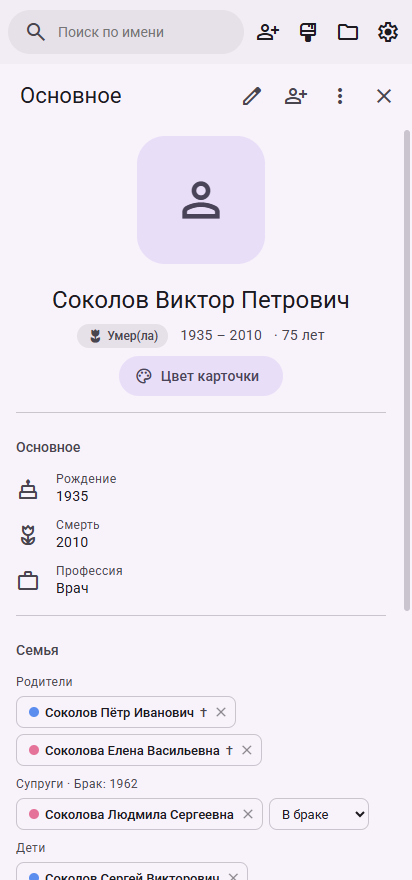
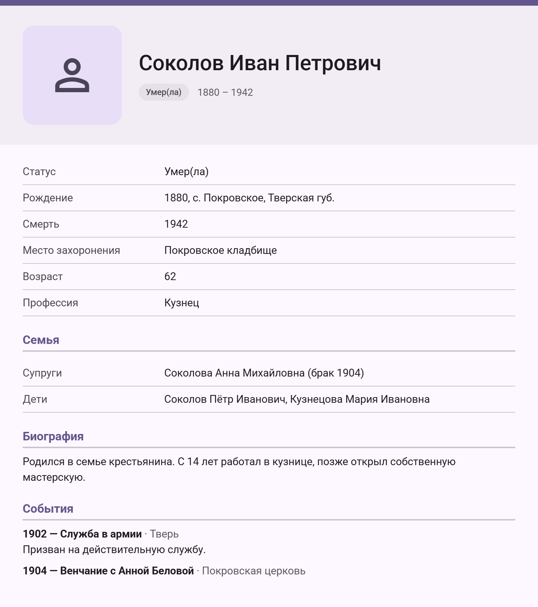

# Родословная

**Genealogy tree app for Windows and Android.** Build a family tree, highlight family lines
with colors and comments, keep a card with photos, documents and a timeline for every relative.
Files are standard GEDCOM, so trees move freely between Rodoslovnaya, Family Gem, MyHeritage,
Gramps and other programs. Interface in Russian and English; Material Design 1, Material Design 3
and Windows 95 styles, light and dark themes. — [Download](https://github.com/disgusty/rodoslovnaya/releases/latest)

---

Приложение для составления генеалогического древа — для Windows и Android.



## Скачать

На странице [Releases](https://github.com/disgusty/rodoslovnaya/releases/latest):

| Файл | Для чего |
|---|---|
| `Rodoslovnaya-Setup-1.0.0.exe` | установщик для Windows 10/11 (x64) |
| `Rodoslovnaya-Portable-1.0.0.exe` | Windows без установки — один файл |
| `Rodoslovnaya-1.0.0.apk` | Android 7.0 и новее |

- **Windows.** Программа не подписана платным сертификатом, поэтому при первом запуске может появиться
  окно «Система Windows защитила ваш компьютер». Нажмите «Подробнее» → «Выполнить в любом случае».
- **Android.** Скачайте APK на телефон и откройте его. Установку из этого источника нужно один раз разрешить,
  телефон предложит это сам.

## Возможности

- **Древо** в духе FamilyGen: раскладка по поколениям, супруги рядом, дети под парой.
  Перетаскивание, масштаб колесом мыши или двумя пальцами.
- **Сворачивание ветвей** кнопкой на карточке. Кнопки в углу (угол выбирается в настройках):
  «Развернуть древо» — полноэкранный режим и раскрытие всех ветвей; «Повернуть» — направление
  по часовой стрелке: сверху вниз → справа налево → снизу вверх → слева направо.
- **Живые и умершие**: зелёная точка у живых; траурная лента, «†» и чёрно-белое фото у умерших.
- **Карточка человека** по нажатию на имя: фото, даты и места, биография, заметки, хронология событий,
  галерея, прикреплённые документы, родственники. Свой цвет карточки у каждого человека.
- **Ветви и линии**: выделение цветом всех потомков или предков человека с комментарием,
  а также цвет и комментарий для любой отдельной связи.
- **Файлы**: автосохранение; проект сохраняется в GEDCOM без потерь; экспорт древа в PNG и PDF,
  карточки — в ODT и PNG. Открываются GEDCOM в UTF-8, UTF-16, Windows-1251/1252 и ANSEL.
- **Оформление**: Material Design 1, Material Design 3 или Windows 95 (по мотивам
  [Windows 95 UI Kit](https://github.com/themesberg/windows-95-ui-kit)), светлая, тёмная или
  системная тема, любой акцентный цвет, русский или английский язык.
- **Большие древа**: рисуется только видимая часть, при отдалении — упрощённый вид.
  Проверено на древе из 34 тыс. человек.

| Ветви и линии | Material Design 1, тёмная тема | Windows 95 |
|---|---|---|
|  |  |  |

| Android: древо | Android: карточка | Экспорт карточки |
|---|---|---|
|  |  |  |

## Файлы и данные

- **`.ged`** — формат программы: стандартный GEDCOM 5.5.1. То, чего в GEDCOM нет (цвета карточек,
  ветви и линии с комментариями, фото, документы), записывается в собственные теги `_FT_…`:
  другие программы их пропускают, а «Родословная» восстанавливает всё без потерь.
- **`.ftree` / `.json`** — проекты ранних версий, по-прежнему открываются.
- Файлы `.ged` открываются двойным щелчком (Windows) и через «Открыть с помощью» или «Поделиться» (Android).
- Автосохранение: Windows — `%APPDATA%\Родословная\tree.json`, Android — внутренняя память приложения.

Горячие клавиши (Windows): `Ctrl+S` — сохранить, `Ctrl+Z` / `Ctrl+Y` — отменить / повторить,
`F11` — полноэкранный режим, `Ctrl+Enter` — сохранить карточку.

## Сборка из исходников

Нужен [Node.js](https://nodejs.org) 20 или новее.

```powershell
npm install
npm start              # собрать и запустить (Windows)
npm run dev            # режим разработки с горячей перезагрузкой
npm run dist           # установщик и portable-версия → release/
npm run typecheck      # проверка типов
npm run test:gedcom    # тесты GEDCOM на файлах из test-data/ (см. test-data/README.md)
```

### Android

Нужны JDK 21 и Android SDK (платформа 36, build-tools 35). Путь к SDK — в `android/local.properties`
(`sdk.dir=…`), ключ подписи релиза — в `android/keystore.properties`:

```properties
storeFile=rodoslovnaya-release.jks
storePassword=…
keyAlias=rodoslovnaya
keyPassword=…
```

```powershell
npm run apk            # → android/app/build/outputs/apk/release/app-release.apk
npm run android:assets # пересоздать иконки и заставку после правки build/icon.svg
```

Без `keystore.properties` релизный APK собирается неподписанным; для проверки подойдёт
`cd android && .\gradlew.bat assembleDebug`.

## Структура проекта

```
electron/            окно Windows-версии: протокол app://, диалоги, автосохранение, открытие файлов
android/             Android-проект (Capacitor); FilesPlugin.java — открытие и сохранение файлов,
                     «Открыть с помощью», «Поделиться»
src/
  main.tsx, App.tsx  запуск, тема, горячие клавиши, каркас окна
  model/             данные (люди + семьи, как в GEDCOM), состояние с отменой/повтором,
                     индекс родственных связей, раскраска ветвей, демо-древо
  tree/              раскладка по поколениям, холст древа, карточки, линии, упрощённый вид
  panels/            верхняя панель, карточка человека, ветви и линии, настройки
  io/                платформа (Windows / Android), меню «Файл», GEDCOM, экспорт PNG/PDF/ODT
  ui/                компоненты интерфейса, темы MD1/MD3/Win95, перевод
  styles/            стили, в том числе Windows 95 и мобильная вёрстка
build/               иконка программы
scripts/             иконки, тесты GEDCOM
docs/screenshots/    изображения для этого README
```

## Лицензия

[MIT](LICENSE) © 2026 disgusty. Сторонние компоненты и их лицензии — в [THIRD_PARTY_NOTICES.md](THIRD_PARTY_NOTICES.md).
